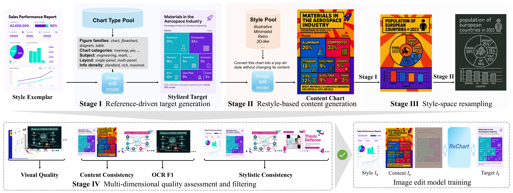

<div align="center">

# 🎨 ChartStyle-100K: A Large-Scale Dataset for Structured Visualization Style Transfer

### 🏆 Accepted to ECCV 2026

<!--
<p align="center">
  Yuwei Yang<sup>1*†</sup>,
  Tianchi Xie<sup>2*†</sup>,
  Jinhong Ni<sup>1*†</sup>,
  Yukai Guo<sup>2†</sup>,
  Jing Zhang<sup>1</sup>,
  Liang Zheng<sup>1</sup>,
  Yalong Bai<sup>3</sup>,
  Yuhui Yuan<sup>3</sup>
</p>

<p align="center">
  <sup>1</sup>Australian National University &nbsp;&nbsp;
  <sup>2</sup>Tsinghua University &nbsp;&nbsp;
  <sup>3</sup>Canva Research
</p>

<p align="center">
  <sup>*</sup>Equal contribution &nbsp;&nbsp;
  <sup>†</sup>Work done during an internship at Canva
</p>
-->

[](https://link.springer.com/chapter/10.1007/978-3-032-36987-1_18)
[](https://chartstyle-100k.github.io/)
[](https://huggingface.co/datasets/ChartFoundation/ChartStyle-100k)
[](https://huggingface.co/datasets/ChartFoundation/ChartStyleBench)
[](#-license)
[](#)

<p align="center">
  
</p>

<em>ChartForge — the four-stage pipeline used to synthesize ChartStyle-100K.</em>

</div>

---

## ✨ Overview

**Structured visualization style transfer** is the task of restyling a *content* visualization
(a chart, flowchart, diagram, or table) to match the visual appearance of a *style reference*,
**while preserving the content's data, text, and structural semantics**.

This repository organizes everything around that task:

- **ChartStyle-100K** — a large-scale training set of **100,744 image triplets**
  `(style reference, content image, target image)` spanning charts, flowcharts, diagrams, and tables.
- **ChartStyle-Bench** — a curated **300-pair** evaluation benchmark of `(style reference, content image)`
  inputs for which a model must produce a faithfully restyled output.
- **ChartForge** — the fully reproducible **four-stage data-generation pipeline** used to synthesize
  ChartStyle-100K. The pipeline code lives in [`pipeline/`](pipeline/).

---

## 🌟 Highlights

- 🧩 **Structured style transfer** across four visualization families — charts, flowcharts, diagrams, and tables.
- 🖼️ **Triplet supervision** — every training sample pairs a style reference and a content image with a ground-truth restyled target.
- 🔎 **Content-preservation focus** — geometry, text, labels, and layout must survive the restyle; the benchmark is designed to expose **content leakage** from the style reference.
- 🛠️ **Open & reproducible** — the full four-stage ChartForge pipeline, including all prompts, is open-sourced so you can regenerate or extend the dataset.

---

## 📁 Repository Structure

```
ChartStyle/
├── README.md
├── requirements.txt                   # Python dependencies (install from repo root)
├── pipeline/                          # ChartForge data-generation pipeline (local, no remote storage)
│   ├── stage1_target_generation.py    # Stage I  : Reference-driven target generation
│   ├── stage2_content_generation.py   # Stage II : Restyle-based content generation
│   ├── stage3_style_resampling.py     # Stage III: Style-space resampling
│   ├── stage4a_quality_filtering.py   # Stage IV (1/3): LLM multi-dimensional scoring
│   ├── stage4b_ocr_filtering.py       # Stage IV (2/3): OCR F1 content-preservation check
│   ├── stage4c_aggregate_filter.py    # Stage IV (3/3): threshold aggregation & final selection
│   ├── common.py                      # Shared helpers (image IO, API calls, filename utils)
│   ├── configs/
│   │   └── pools.py                   # Chart types, task types, subjects, style families
│   ├── prompts/
│   │   ├── chart_generation.py        # Stage I/II prompts — chart domain
│   │   ├── fdt_generation.py          # Stage I/II prompts — flowchart / diagram / table
│   │   └── evaluation.py              # Stage IV LLM judge prompts (quality / content / style)
│   └── utils/
│       └── select_stage3_references.py  # Selects Stage-II outputs as Stage-III style references
└── evaluation/                        # ChartStyle-Bench evaluation (inference + local scoring)
    ├── run_eval.py                    # CLI: model registry + scorer selection
    ├── harness.py                     # generate → score → aggregate → save (no remote upload)
    ├── dataset.py                     # loads ChartStyle-Bench from the HF Hub (Parquet)
    ├── prompts/                       # generation prompt + LLM-judge prompts
    ├── models/                        # Qwen-Image-Edit, gpt-image-*, Nano Banana Pro
    └── scorers/                       # CLIP (semantic/fidelity), GPT-4o judges (content/style/leakage), OCR
```

---

## 📊 ChartStyle-100K (Training Data)

🤗 **[ChartFoundation/ChartStyle-100k](https://huggingface.co/datasets/ChartFoundation/ChartStyle-100k)**

Each record is a training triplet:

| Field            | Type   | Description |
| ---------------- | ------ | ----------- |
| `sample_id`      | string | Unique identifier for the triplet. |
| `style_reference`| image  | Visualization image that defines the desired visual style. |
| `content_image`  | image  | Visualization image whose data and semantic content must be preserved. |
| `target_image`   | image  | Restyled visualization — the training target. |
| `content_type`   | string | Fine-grained type for charts (e.g. `bar`, `pie`, `sankey`, `treemap`); `null` for flowchart/diagram/table families. |
| `content_subject`| string | Topical domain of the content (e.g. Finance, Biology, Education). |

### Content distribution (100,744 triplets)

| Content family | Count   | Percentage |
| -------------- | ------- | ---------- |
| Chart          | 76,122  | 75.6%      |
| Diagram        | 11,244  | 11.2%      |
| Flowchart      | 10,143  | 10.1%      |
| Table          | 3,235   | 3.2%       |
| **Total**      | **100,744** | **100%** |

The dataset spans **a broad range of fine-grained chart types** (bar, pie, line, funnel, donut,
treemap, bullet, sankey, waterfall, radar, heatmap, …) and **balanced topical subjects**
(Marketing, Psychology, Education, Public Health, Biology, Statistics, Finance, Physics, …).

### Loading

```python
from datasets import load_dataset

# Quick preview (100 samples, shown in the Hugging Face Dataset Viewer)
preview = load_dataset("ChartFoundation/ChartStyle-100k", "preview", split="preview")

# Full training set (100,744 triplets)
dataset = load_dataset("ChartFoundation/ChartStyle-100k", "train", split="train")

sample = dataset[0]
sample["style_reference"]  # PIL.Image
sample["content_image"]    # PIL.Image
sample["target_image"]     # PIL.Image
```

---

## 🥇 ChartStyle-Bench (Benchmark)

🤗 **[ChartFoundation/ChartStyleBench](https://huggingface.co/datasets/ChartFoundation/ChartStyleBench)**

A standalone, human-curated benchmark of **300 input pairs**. Benchmark images are collected
independently and **do not overlap** with the synthetic ChartStyle-100K training data, so they
provide a clean, leakage-aware test of structured style transfer.

| Field            | Type   | Description |
| ---------------- | ------ | ----------- |
| `id`             | string | Sample identifier (`001`–`300`). |
| `style_reference`| image  | Style reference visualization. |
| `content_image`  | image  | Content visualization to be restyled. |
| `content_type`   | string | One of `chart` (with fine-grained type), `flowchart`, `diagram`, `table`. |

### Benchmark composition (300 pairs)

| Content family | Count |
| -------------- | ----- |
| Chart          | 150   |
| Flowchart      | 66    |
| Diagram        | 42    |
| Table          | 42    |
| **Total**      | **300** |

---

## 🚀 Getting Started

**1. Install dependencies** (Python 3.10+), from the repository root:

```bash
pip install -r requirements.txt
# Stage IV-b (OCR) needs a PaddlePaddle build matching your GPU/CUDA — see the notes
# in requirements.txt. Example for modern CUDA-12 GPUs (e.g. H100/H200):
pip install paddlepaddle-gpu==3.0.0 -i https://www.paddlepaddle.org.cn/packages/stable/cu126/
```

**2. Configure your OpenAI API key** — used by Stage I, II, III, and the Stage IV quality scorer.
Either export it, or place it in a `.env` file (Stage I/II auto-load `.env` via `python-dotenv`):

```bash
export OPENAI_API_KEY=sk-...
# or:  echo "OPENAI_API_KEY=sk-..." > pipeline/.env
```

**3. Provide inputs & run.** Stage I consumes a folder of **style reference images**; outputs are
written to a local directory (default `./output`, override with `CHARTFORGE_OUTPUT_ROOT`). Once the
key is set, you can start generating with the commands below.

---

## ♻️ Data Generation — the ChartForge Pipeline

ChartStyle-100K is produced by **ChartForge**, a four-stage synthesis pipeline. Run all commands
from the `pipeline/` directory.

> **Image model.** Every generation stage accepts `--model`. The paper uses **`gpt-image-1`** (the
> default). We **recommend the latest `gpt-image-2`** for higher-quality generations — simply pass
> `--model gpt-image-2` to Stages I–III. Note that image generation requires an OpenAI organization
> verified for image models.

### Stage I — Reference-driven target generation
From a style reference image, generate a high-quality **target** visualization, randomly sampling the
subject, type, information density, and layout (number and type of elements). For flowchart/diagram/table
(FDT) scenarios, the complexity of the generated image is explicitly controlled for diversity.

```bash
python stage1_target_generation.py --domain chart   --images-subdir <reference-images-subdir> ...
python stage1_target_generation.py --domain fdt     --images-subdir <reference-images-subdir> ...
```

### Stage II — Restyle-based content generation
Reverse-construct the **content** image from each target by re-styling its appearance to a randomly
sampled style family (from a large pool of style families), while preserving the target's structure.
This produces the `(style reference, content image, target image)` triplets.

```bash
python stage2_content_generation.py --domain chart ...
python stage2_content_generation.py --domain fdt   ...
```

### Stage III — Style-space resampling
Expand the dataset by reusing the Stage I/II prompts, replacing the reference images with the
content images selected from Stage II — broadening style coverage.

```bash
python utils/select_stage3_references.py --manifest <stage2-manifest.json> --dest-root <refs-dir>
python stage3_style_resampling.py --summary-json <refs-dir>/selection_summary.json
```

### Stage IV — Multi-dimensional quality assessment & filtering
Run in order; the aggregation step is **last**:

```bash
# (1/3) GPT-4o judges: visual quality (content & target), content consistency, stylistic consistency
python stage4a_quality_filtering.py --jsonl <triplets>.jsonl --ratings-dir output/.../ratings

# (2/3) PaddleOCR token-level F1 between content and target text
python stage4b_ocr_filtering.py --jsonl <triplets>.jsonl --ratings-dir output/.../ratings

# (3/3) aggregate all scores, apply per-metric thresholds, write the final filtered JSONL
python stage4c_aggregate_filter.py
```

---

## 🏆 Evaluation

The [`evaluation/`](evaluation/) directory provides a self-contained harness that runs a model
over **ChartStyle-Bench** and scores its outputs. Benchmark images are loaded directly from the
Hugging Face Hub. Run all commands from the `evaluation/` directory.

### Models

| Model key | Backend |
| --------- | ------- |
| `qwen-image-edit` | Qwen-Image-Edit (local diffusers, multi-GPU; 40-step default, `--qwen-fast` for 8-step Lightning) |
| `gpt-image-1` / `gpt-image-1.5` / `gpt-image-2` | OpenAI `images.edit` |
| `nano-banana-pro` | Google Gemini image (`gemini-3-pro-image-preview`) |

### Metrics

GPT-4o is the judge for the LLM-based metrics; **Overall Score** is derived (not a separate judge).
The `--scorers` CLI aliases are short; the result keys use the paper's full metric names.

| Type | CLI alias | Result key (paper metric) | Definition |
| ---- | --------- | ------------------------- | ---------- |
| LLM  | `content`  | `content_consistency` ↑ | How well the output preserves the original content, 1–5 |
| LLM  | `style`    | `style_similarity` ↑    | How closely the output adheres to the reference style, 1–5 |
| LLM  | `leakage`  | `content_leakage` ↓     | 1 if reference elements leak into the output, else 0 |
| CLIP | `semantic` | `semantic_consistency` ↑ | CLIP cosine similarity (content ↔ output) |
| CLIP | `fidelity` | `clip_stylistic_fidelity` ↑ | CLIP cosine similarity (style ref ↔ output) |
| OCR  | `ocrscore` | `ocr_score` ↑           | PaddleOCR word-level F1 (content ↔ output) |

**`overall_score`** ↑ is the harmonic mean of `content_consistency` and `style_similarity`,
with `style_similarity` set to 1 when content leakage is detected.

### Setup & run

LLM judges and `gpt-image-*` need `OPENAI_API_KEY`; `nano-banana-pro` needs `GOOGLE_API_KEY`.
The CLIP / diffusers / google-genai dependencies are included in the top-level `requirements.txt`.

```bash
cd evaluation
export OPENAI_API_KEY=sk-...

python run_eval.py --model gpt-image-1 --limit 20 --concurrency 8
```

Key arguments:

- `--model` — model to evaluate; one of `qwen-image-edit`, `gpt-image-1`, `gpt-image-1.5`, `gpt-image-2`, `nano-banana-pro` (see the table above).
- `--scorers` — subset of metrics to run; default is all six (`content style leakage semantic fidelity ocrscore`).
- `--limit` — evaluate only the first N pairs; omit to run all 300.
- `--concurrency` — number of pairs generated and scored in parallel.
- `--output-dir` — directory for results and generated images (default `eval_results`).
- `--qwen-fast` — for `qwen-image-edit` only: use the 8-step Lightning path instead of the 40-step default.

Results are written to `eval_results/<model>_<timestamp>/`:

```
images/<id>.png   # generated restyled outputs
results.json      # per-sample scores + judge reasoning + generation metadata
summary.json      # aggregate mean/min/max per metric (+ leakage rate)
```

---

## 🔧 Model Training & Inference

Training and inference use the **Qwen-Image-Edit-2509** base model with a two-image edit input
(`style reference` + `content image` → restyled target):

- **LoRA training** — [training script](https://github.com/modelscope/DiffSynth-Studio/blob/main/examples/qwen_image/model_training/lora/Qwen-Image-Edit-2509.sh)
- **Inference** — [inference script](https://github.com/modelscope/DiffSynth-Studio/blob/main/examples/qwen_image/model_training/validate_lora/Qwen-Image-Edit-2509.py)

---

<!--
## 📜 Citation

If ChartStyle-100K is useful to your research, please consider citing our work:

```bibtex
@inproceedings{yang2026chartstyle,
  title     = {ChartStyle-100K: A Large-Scale Dataset for Structured Visualization Style Transfer},
  author    = {Yang, Yuwei and Xie, Tianchi and Ni, Jinhong and Guo, Yukai and
               Zhang, Jing and Zheng, Liang and Bai, Yalong and Yuan, Yuhui},
  booktitle = {Proceedings of the European Conference on Computer Vision (ECCV)},
  year      = {2026}
}
```

---
-->

## ✅ License

- **Code** (`pipeline/` and `evaluation/`) is released under the **Apache License 2.0** — see [`LICENSE`](LICENSE).
- **Datasets** (ChartStyle-100K & ChartStyle-Bench) are released under **CC BY-SA 4.0**, as stated on
  each Hugging Face dataset card
  ([ChartStyle-100K](https://huggingface.co/datasets/ChartFoundation/ChartStyle-100k),
  [ChartStyle-Bench](https://huggingface.co/datasets/ChartFoundation/ChartStyleBench)).
